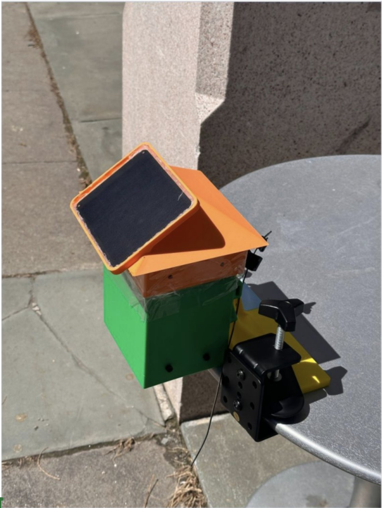

# Sensor Enclosure Bias Prediction

Designed and built four printed air-quality enclosure revisions, including an
outdoor prototype. The work combined CAD, sensor and power integration, airflow
and rain-path packaging, mounting, and service access.



[Build photographs and CAD](docs/hardware/README.md) ·
[Portfolio case study](https://www.mergenulziibayar.com/projects/sensor-enclosure-bias-prediction)

## Thermal analysis

How much design-specific co-location can measured geometry, material and power
data plus shared thermal laws replace, at comparable prediction error? The
repository contains steady and transient heat-balance calculations, checks
of the transient solver, and a literature review of the model inputs. The
planned first field study will compare enclosure temperatures with a calibrated
reference thermometer. Prediction for an enclosure excluded from model fitting
has not been tested.

[](https://github.com/500ft/sensor-enclosure-bias-prediction/actions/workflows/ci.yml)
[](docs/results.md)
[](.github/workflows/ci.yml)

[Results](#results) · [Roadmap](ROADMAP.md) · [Quick start](#quick-start) ·
[Pilot protocol](docs/COLOCATION_PROTOCOL.md)


Simulation: nominal steady-state bias from the lumped heat-balance model, without propagated input uncertainty. Air 30 °C, true RH 50 %, clear sky 20 K below air. Panels (a) to (d) show sensor minus air temperature and panels (e) to (h) reported minus true relative humidity in percentage points, against external wind speed from 0 to 5 m/s, for the baseline closed box (V0, circles; (a) and (e)), painted closed-box control (V0P, squares; (b) and (f)), passive multi-plate shield (V1, triangles; (c) and (g)), and actively aspirated reference (V2, diamonds; (d) and (h)). Solid lines are 1000 W/m² of sun and dashed lines 800 W/m². Panels in a row share axes. The thin line marks zero: above it the sensor reads warm, below it the sensor reads dry. Across both solar loads the baseline box reads 6 to 23 °C warm and 15 to 35 points dry; the other three read 0.7 to 5.3 °C warm and 2 to 13 points dry. Values at five wind speeds: `analysis/output/thermal_bias_table.csv`. Model and inputs: `analysis/thermal_bias.py`.

[Caption](analysis/figures/thermal_bias.caption.md) ·
[Figure inputs](docs/data-and-figures.md#thermal-bias-plot) ·
[Vector figure](analysis/figures/thermal_bias.svg).

The [full-text prior-work assessment](ProConsList/jin2026sensors.md) documents
CFD-trained correction with separate outdoor evaluation on the developed shield.
The adopted question compares held-out-design transfer and total effort.

The [synthetic heater power-step study (I1)](analysis/output/synthetic_identifiability_report.md)
examines which parameters a temperature record can identify. In its single-node
model, measured power steps identify the time constant `C/G` and temperature
gain per watt `eta/G`, where `C` is effective heat capacity, `G` is heat-loss
conductance and `eta` is the fraction of electrical heat reaching the modeled
node. They cannot separate the three absolute parameters without an independent
measurement. Ambient mismatch can also defeat interval coverage. The study used
assumed instrument behavior; no physical I1 test or withheld-design comparison
has run.

## About

An outdoor sensor can end up measuring its own enclosure instead of the air.
Sunlight heats the walls, still air traps the heat, and the electronics inside
add their own. The error changes with time of day, so a single midday check can
mislead.

The project compares enclosure options with a first-order heat-balance model,
checks the model's constants against the literature, and prepares a
co-location pilot: the enclosures mounted next to a reference thermometer for
at least a full day and night. The PI has approved the pilot in principle and offered a test
site and manufacturing help.

The plotted versions are the dark closed box (V0), the same box with a finish
change (V0P), a passive vented shield (V1), and an aspirated model reference
(V2). The draft physical protocol lists V0, V0P and V1; V2 is not an identified
pilot unit. The [protocol's setup table](docs/COLOCATION_PROTOCOL.md#r12-enclosures-and-reference)
defines the optional unpowered V0 arm and the actual reference thermometer.
Its [intervention table](docs/COLOCATION_PROTOCOL.md#c2-intervention-matrix)
defines I1 through I6: power, sunlight, ventilation, finish, whole-design and
optional aspiration comparisons. Parameter IDs such as `P-QINT-V0` identify
model inputs in the [parameter register](docs/PARAMETER_REGISTER.csv), where
their units and evidence status are recorded.

## Results

At 1000 W/m² of sun and 0.5 m/s of wind, the model gives these nominal point
estimates of temperature rise above ambient:

| Enclosure | Predicted rise [°C] |
| --- | ---: |
| Dark closed box (V0) | 19.4 |
| Same box, painted white (V0P) | 4.5 |
| Passive radiation shield (V1) | 3.0 |

At this operating point, changing the dark box's absorptance to the white-paint
assumption accounts for most of the predicted reduction. The shield's nominal
bias is about 1.5 °C lower than the painted box's. Geometry, internal heat load
and airflow also differ between these systems.
[Prediction table](analysis/output/thermal_bias_table.csv).

The shield-versus-painted-box ranking reverses when the documented sensitivity
settings for poorer shading, reduced convection and increased plate-air preheat
are applied together. These settings are illustrative, and this model comparison
establishes no design preference.
[Sensitivity results and assumptions](analysis/thermal_bias_results.md),
[calculation](analysis/matched_control_sensitivity.py).
At night the modelled bias can change sign, which is why the pilot covers both
day and night.

The [corrected transient calculation](docs/results.md#transient-result)
stores its initial state at the right time, conserves hourly solar input and
passes exact thermal-step and timestep-refinement checks. Its figure shows a
clear-sky assumption and sensitivity to declared inputs. Missing acquisition
metadata and actual sky forcing limit interpretation. No physical accuracy or design-transfer result has been obtained.


Simulation: clear-sky scenario driven by archived hourly Open-Meteo weather from 2026-09-02 04:00 to 2026-09-15 03:00 UTC; the first 24 h are spin-up and are not shown. Panel (a) is the hourly mean solar irradiance, held over each preceding hour; daily peaks range from 300 to 839 W/m². Panel (b) is the wind speed at 10 m, between 0.25 and 5.2 m/s. Panels (c) to (f) share axes and show sensor minus air temperature for the baseline closed box (V0, circles; (c)), painted closed-box control (V0P, squares; (d)), passive multi-plate shield (V1, triangles; (e)), and actively aspirated reference (V2, diamonds; (f)). Each line is the median of 400 input draws and the grey band spans their 5th to 95th percentiles; the bands show sensitivity to assumed input ranges, not measured uncertainty. Above the thin zero line the sensor reads warm. The baseline box's median bias peaks at 5 to 14 °C each day; the other three stay below 4 °C. The final day is incomplete. Summaries: `analysis/output/thermal_transient_prediction.json`. Weather: `analysis/input/openmeteo_brooklyn_20260901_20260914.json`. Model: `analysis/thermal_transient.py`. The weather file's acquisition details are unknown.

[Caption](analysis/figures/thermal_transient_prediction.caption.md) ·
[Inputs, method and reproduction](docs/data-and-figures.md#transient-prediction-plot) ·
[Vector figure](analysis/figures/thermal_transient_prediction.svg).

Other work in the repository:

- **Literature.** A [26-source matrix](literature/literature_matrix.csv) with
  [source assessments](ProConsList/README.md), and a later review of 27 more
  sources against the model's previously uncited constants.
- **Uncertainty.** The steady tables are point estimates. The transient
  draft carries sensitivity bands from assumed uniform ranges by Monte Carlo. The
  standalone [linear propagation module](analysis/uncertainty.py) is tested but
  not connected to either.
- **Reliability accounting.** [Schedule-aware metrics](docs/RELIABILITY_METRICS.md)
  for deployed units. The historical percentages need raw exports that are not
  in this repository, so they are reported but unverified.
- **CAD.** The baseline enclosure is parametric and was accepted against an
  independent closed-form check of volume, bounding box and STEP re-import.

## Quick start

Python 3.12, the CI version. These checks use only files in the repository.

```bash
git clone https://github.com/500ft/sensor-enclosure-bias-prediction.git
cd sensor-enclosure-bias-prediction
python -m venv .venv
source .venv/bin/activate
python -m pip install -r requirements.txt
python -m compileall -q analysis
PYTHONPATH=. python -m unittest discover -s analysis/tests -v
python analysis/check_literature_coverage.py
```

To regenerate the model tables without overwriting the committed ones:

```bash
OUT_DIR="$(mktemp -d)"
python analysis/thermal_bias.py --no-figure \
  --table "$OUT_DIR/thermal-day.csv" \
  --night-table "$OUT_DIR/thermal-night.csv"
diff -u analysis/output/thermal_bias_table.csv "$OUT_DIR/thermal-day.csv"
diff -u analysis/output/thermal_bias_night_table.csv "$OUT_DIR/thermal-night.csv"
```

No diff means the tables reproduce in your environment. The
[reading guide](docs/START_HERE.md#reviewer-reproduce-the-contained-analysis)
covers external-data prerequisites and the intake checker.

## What's next

The [roadmap](ROADMAP.md) orders the equipment check, the power-step experiment,
field comparisons and the withheld-design effort comparison. The next work
needs the actual enclosure and instrument inventory, reference calibration,
fixed-airflow capability, site/data terms and a usable resource budget. The
[current decision and equipment record](docs/COLOCATION_OWNER_SESSION.md#current-blocker)
tracks those missing inputs.

The first stage reports estimated bias, uncertainty and model error without a
pass/fail verdict. A later claim that co-location can be skipped needs an
application-specific tolerance agreed with the PI before that claim is tested.
Total effort includes geometry, material and power measurements, setup,
calibration and deployment. External designs or exposure regimes require a
separate decision.

## Limits

- The published steady model is lumped; the transient extension has no field data yet. One 24-hour campaign would not
  establish seasonal accuracy.
- The pilot protocol is a draft until it is frozen with its approver and date.
  Its data-quality targets are proposals, and the model's day and night
  scenarios are not acceptance limits.
- The intake checker catches malformed data. It cannot prove where data came
  from, and a file that passes it is not a thermal validation.

## Documentation

| Document | What it covers |
| --- | --- |
| [Reading guide](docs/START_HERE.md) | Where to start |
| [Results](docs/results.md) | What is modelled, provisional or unavailable |
| [Data and figures](docs/data-and-figures.md) · [manifest](docs/figure-manifest.json) | Where each plot and input came from |
| [Model assumptions](analysis/thermal_bias_results.md) | Geometry, radiation and convection terms |
| [Pilot protocol](docs/COLOCATION_PROTOCOL.md) | What the side-by-side test measures |
| [Study decisions and equipment requirements](docs/COLOCATION_OWNER_SESSION.md#current-blocker) | Current physical prerequisites |
| [Decision history](docs/OWNER_DECISIONS_2026-09-24.md) | Recorded choices and unanswered questions |
| [Working manuscript](paper/manuscript_v1.md) | Literature and analysis written up |
| [Geometry reference](docs/cad_geometry_reference.md) | Retained CAD inputs and geometry checks |

```text
analysis/      thermal and reliability models, intake checks, tests and figures
literature/    source matrix and design comparisons
ProConsList/   per-source assessments
paper/         working manuscript and bibliography
templates/     record templates for baselines, deployments and calibration
docs/          methods, results and protocols
evidence/      recorded checks
```

## Contributing and reuse

Read [CONTRIBUTING.md](CONTRIBUTING.md). Literature changes must keep the
bibliography, matrix, assessments and synthesis in sync. Analysis changes need
a reproduction, units, input sources and tests.

There is no open-source license yet; contact the owner about reuse or about
the nonpublic data. When referencing the work, give the commit and say that
the results are modelled. The project's earlier name is explained in the
[identity note](docs/REPOSITORY_IDENTITY.md).
