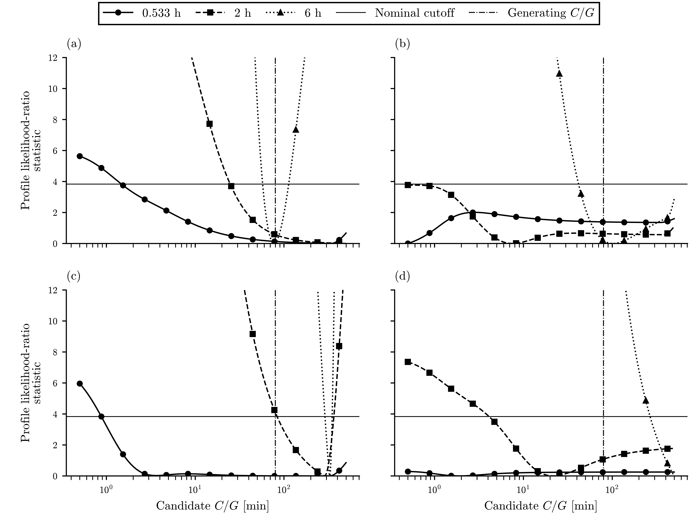
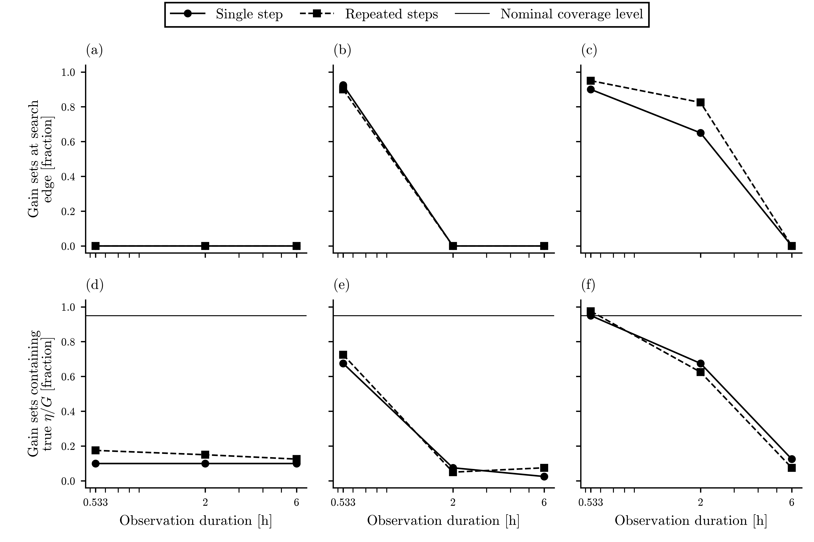

# Executed synthetic I1 design aid at 60 s sampling cadence (registered amendment)

Executed 72 scenario cells with 2880 synthetic fits. Estimation-only reporting is retained.

Source: [numeric result](synthetic_identifiability_60s.json), [all-cell CSV](synthetic_identifiability_60s.csv), [profile arrays](synthetic_identifiability_60s_profiles.npz). This page is generated from those outputs.

Registration: [amendment file](../input/identifiability_design_60s.json), which amends the registered design and records why the shortest cell changed. The design aid, its limits and the pending physical inputs are unchanged; this run tests the sampling cadence only.

## Comparison with the registered 15 s run

Cadence 60 s against the registered 15 s ([result](synthetic_identifiability.json), [CSV](synthetic_identifiability.csv)). Cells are matched by scenario, time constant, schedule and duration rank. The shortest cell is 0.533 h here against 0.5 h registered, with 6.7 % more input energy; the other durations and energies are equal. Coupling, offset and excursion-phase draws are shared between the two runs; noise realizations are not. Each cell has 40 draws, so a change below 16 percentage points is within two Monte Carlo standard errors. Per-cell values and changes: `cadence_comparison` in the numeric result.

| Scenario | C/G [min] | Schedule | Gain open [%] 15 s | Gain open [%] 60 s | Gain coverage [%] 15 s | Gain coverage [%] 60 s | Time-constant open [%] 15 s | Time-constant open [%] 60 s |
| --- | ---: | --- | ---: | ---: | ---: | ---: | ---: | ---: |
| matched | 5 | single step | 0.0 | 0.0 | 92.5 | 97.5 | 0.0 | 0.0 |
| matched | 5 | repeated steps | 0.0 | 0.0 | 95.0 | 97.5 | 0.0 | 0.0 |
| matched | 20 | single step | 0.0 | 0.0 | 90.0 | 97.5 | 0.0 | 0.0 |
| matched | 20 | repeated steps | 0.0 | 0.0 | 92.5 | 95.0 | 0.0 | 0.0 |
| matched | 80 | single step | 0.0 | 0.0 | 87.5 | 95.0 | 0.0 | 0.0 |
| matched | 80 | repeated steps | 0.0 | 0.0 | 92.5 | 97.5 | 0.0 | 0.0 |
| noisy | 5 | single step | 0.0 | 0.0 | 90.0 | 95.0 | 0.0 | 0.0 |
| noisy | 5 | repeated steps | 0.0 | 0.0 | 95.0 | 95.0 | 0.0 | 0.0 |
| noisy | 20 | single step | 0.0 | 0.0 | 95.0 | 90.0 | 0.0 | 0.0 |
| noisy | 20 | repeated steps | 0.0 | 0.0 | 87.5 | 92.5 | 0.0 | 0.0 |
| noisy | 80 | single step | 0.0 | 27.5 | 90.0 | 92.5 | 17.5 | 30.0 |
| noisy | 80 | repeated steps | 30.0 | 65.0 | 97.5 | 97.5 | 35.0 | 52.5 |
| ambient mismatch | 5 | single step | 0.0 | 0.0 | 5.0 | 10.0 | 0.0 | 0.0 |
| ambient mismatch | 5 | repeated steps | 0.0 | 0.0 | 7.5 | 12.5 | 0.0 | 0.0 |
| ambient mismatch | 20 | single step | 0.0 | 0.0 | 2.5 | 2.5 | 0.0 | 0.0 |
| ambient mismatch | 20 | repeated steps | 0.0 | 0.0 | 2.5 | 7.5 | 0.0 | 0.0 |
| ambient mismatch | 80 | single step | 0.0 | 2.5 | 2.5 | 12.5 | 12.5 | 17.5 |
| ambient mismatch | 80 | repeated steps | 32.5 | 37.5 | 2.5 | 7.5 | 20.0 | 22.5 |
| probe lag | 5 | single step | 0.0 | 0.0 | 27.5 | 67.5 | 0.0 | 0.0 |
| probe lag | 5 | repeated steps | 0.0 | 0.0 | 0.0 | 0.0 | 0.0 | 0.0 |
| probe lag | 20 | single step | 0.0 | 0.0 | 0.0 | 0.0 | 0.0 | 0.0 |
| probe lag | 20 | repeated steps | 0.0 | 0.0 | 0.0 | 0.0 | 0.0 | 0.0 |
| probe lag | 80 | single step | 10.0 | 15.0 | 0.0 | 0.0 | 100.0 | 100.0 |
| probe lag | 80 | repeated steps | 0.0 | 0.0 | 0.0 | 5.0 | 100.0 | 100.0 |

All rows are the 6 h duration. Under matched dynamics at 6 h, gain sets reach the search edge in 0 of 6 cells at 60 s (0 at 15 s); the largest open fraction is 0.0 % (0.0 % at 15 s). Matched gain coverage is at least 95.0 % (87.5 % at 15 s). Over all 24 cells at this duration, the largest coverage change is -5.0 percentage points in `noisy__tau1200__duration21600__single_step`; 0 cells fall and 1 rise by more than 16 points.

## Slow-response comparison

Generating heater time constant: 80 min. Every registered duration and schedule is shown for this slice; other time constants remain in the CSV. Open means a profile set reaches the registered search boundary. Coverage uses all draws, including open sets.

| Scenario | Duration [h] | Schedule | Gain coverage [%] | Gain open [%] | Time-constant open [%] |
| --- | ---: | --- | ---: | ---: | ---: |
| matched | 0.533 | single step | 90.0 | 90.0 | 95.0 |
| matched | 0.533 | repeated steps | 95.0 | 95.0 | 90.0 |
| matched | 2 | single step | 97.5 | 65.0 | 55.0 |
| matched | 2 | repeated steps | 97.5 | 82.5 | 65.0 |
| matched | 6 | single step | 95.0 | 0.0 | 0.0 |
| matched | 6 | repeated steps | 97.5 | 0.0 | 0.0 |
| noisy | 0.533 | single step | 85.0 | 95.0 | 85.0 |
| noisy | 0.533 | repeated steps | 87.5 | 92.5 | 95.0 |
| noisy | 2 | single step | 97.5 | 100.0 | 92.5 |
| noisy | 2 | repeated steps | 97.5 | 100.0 | 92.5 |
| noisy | 6 | single step | 92.5 | 27.5 | 30.0 |
| noisy | 6 | repeated steps | 97.5 | 65.0 | 52.5 |
| ambient mismatch | 0.533 | single step | 95.0 | 95.0 | 75.0 |
| ambient mismatch | 0.533 | repeated steps | 97.5 | 97.5 | 95.0 |
| ambient mismatch | 2 | single step | 67.5 | 57.5 | 42.5 |
| ambient mismatch | 2 | repeated steps | 62.5 | 82.5 | 45.0 |
| ambient mismatch | 6 | single step | 12.5 | 2.5 | 17.5 |
| ambient mismatch | 6 | repeated steps | 7.5 | 37.5 | 22.5 |
| probe lag | 0.533 | single step | 92.5 | 100.0 | 100.0 |
| probe lag | 0.533 | repeated steps | 87.5 | 97.5 | 100.0 |
| probe lag | 2 | single step | 100.0 | 32.5 | 100.0 |
| probe lag | 2 | repeated steps | 72.5 | 100.0 | 77.5 |
| probe lag | 6 | single step | 0.0 | 15.0 | 100.0 |
| probe lag | 6 | repeated steps | 5.0 | 0.0 | 100.0 |

## Profiles and schedule tradeoffs

Synthetic development example, not physical data. Profile likelihood-ratio statistic against candidate C/G for the first registered draw of each scenario, with the slowest generating heater time constant (80 min) and repeated power steps: (a) matched dynamics with quantization; (b) higher noise with coarser quantization; (c) an unobserved ambient excursion; (d) additional probe lag. Record length: circles with solid lines, 0.533 h; squares with dashed lines, 2 h; triangles with dotted lines, 6 h. Panels share axes. The thin horizontal line is the nominal likelihood-ratio cutoff, 3.84. The dash-dot vertical line marks the generating heater time constant; in the probe-lag case there is no true single-node time constant. Curves are clipped above 12; the full-range profiles are retained. Sources: `analysis/output/synthetic_identifiability_60s.json`, `analysis/output/synthetic_identifiability_60s_profiles.npz` and `analysis/input/identifiability_design_60s.json`.

[Caption](../figures/synthetic_identifiability_60s_profiles.caption.md) · [Vector profiles](../figures/synthetic_identifiability_60s_profiles.svg).

Synthetic development example, not physical data. Each point is the fraction of 40 draws in one cell at equal input energy. Columns are generating C/G of 5, 20 and 80 min. Panels (a) to (c), matched dynamics: the fraction of gain (eta/G) profile sets that reach the registered search edge. Panels (d) to (f), unobserved ambient excursion: the fraction of gain sets that contain the true eta/G; the thin horizontal line is the nominal 95 % level, not a measured performance target. Schedule: circles with solid lines, single step; squares with dashed lines, repeated steps. Lines connect the discrete durations 0.533, 2 and 6 h and do not establish interpolation to an untested schedule. Where both schedules give the same value, the square covers the circle; in (a) that holds at every duration. Longer observations can narrow sets while unmodeled drift defeats coverage: at 6 h no matched gain sets reach the search edge, and ambient-excursion coverage is at most 12.5 %. Sources: `analysis/output/synthetic_identifiability_60s.csv` and `analysis/input/identifiability_design_60s.json`.

[Caption](../figures/synthetic_identifiability_60s_tradeoffs.caption.md) · [Vector tradeoffs](../figures/synthetic_identifiability_60s_tradeoffs.svg).

The JSON duration_information entries give paired log width reduction relative to the shortest same-schedule record. paired_schedule_widths compares single versus repeated steps. Positive values mean narrower repeated-step sets. These are descriptive information proxies, not Bayesian information or entropy. Only pairs with both sets closed contribute; their counts are reported. Null means no eligible pair. They must be read alongside openness and coverage, rather than used to rank schedules alone.

## Numerical validation and resource use

The refinement doubled profile-grid resolution to 3201 points on the same draws. Time-constant coverage changed in 0 fits and gain coverage in 0 fits. Maximum relative estimate changes were 0.22% for time constant and 3.63% for gain. The discrete grid includes each generating time constant to avoid an off-grid truth; this favors recovery slightly compared with an unknown physical parameter. Grid agreement on coverage does not prove continuous optimization accuracy or calibrated uncertainty.

Discrete profile descent from the registered starts reached inferior minima in 7 first-draw cells. The largest excess likelihood-ratio statistic was 287.15. Published fits instead use the minimum across the entire registered grid. The per-cell multiple_starts records preserve these failures; each key and seed regenerates its input.

Exact response superposition, independent RK4, joint-scaling trajectories and interval energy checks passed. Maximum interval-energy residual: 3.55e-14 J. A direct GLS solve independently checked variable projection, and the AR(1) whitening norm matched the full covariance inverse.

| Computation | Elapsed [s] | Peak RSS [MiB] |
| --- | ---: | ---: |
| Registered matrix | 32.41 | 261.0 |
| Profile refinement | 16.82 | 365.3 |

Raw synthetic arrays: 1.02 MiB, retained outside git with per-file hashes. Both runs used one worker and one BLAS/OpenMP thread. Checkpoints contain the exact configuration, generator hash and completed cells.

## Interpretation limits and next input

Each cell has 40 Monte Carlo draws. The maximum binomial Monte Carlo standard error is 7.9 percentage points; the small batches describe failure regimes and do not precisely calibrate nominal coverage. Schedules and durations share random draws; cells are not independent physical replications. Known noise covariance is optimistic, quantization is omitted from the fit covariance, and the ambient excursion period scales with observation duration. Thus the mismatch duration comparison changes both exposure length and drift time scale. Constant calibration offset is profiled as a nuisance; time-varying calibration and power-meter errors need actual specifications.

The profile sets are asymptotic marginal likelihood-ratio sets over finite search domains. Disconnected components and open edges are retained. The CSV's finite-domain widths include truncation and must not be read as finite uncertainty bounds. For probe-lag rows, time-constant inclusion only asks whether the generating heater constant is inside the fitted set; it is not valid coverage of a nonexistent single-node truth.

The owner still supplies the [meeting and rig inputs](../../docs/COLOCATION_OWNER_SESSION.md#current-blocker). Actual response, ambient-channel quality, noise, calibrated power/coupling and airflow independence could change the schedule comparison. Physical M1/M2, I1, protocol freeze and held-out-design comparison remain pending.
