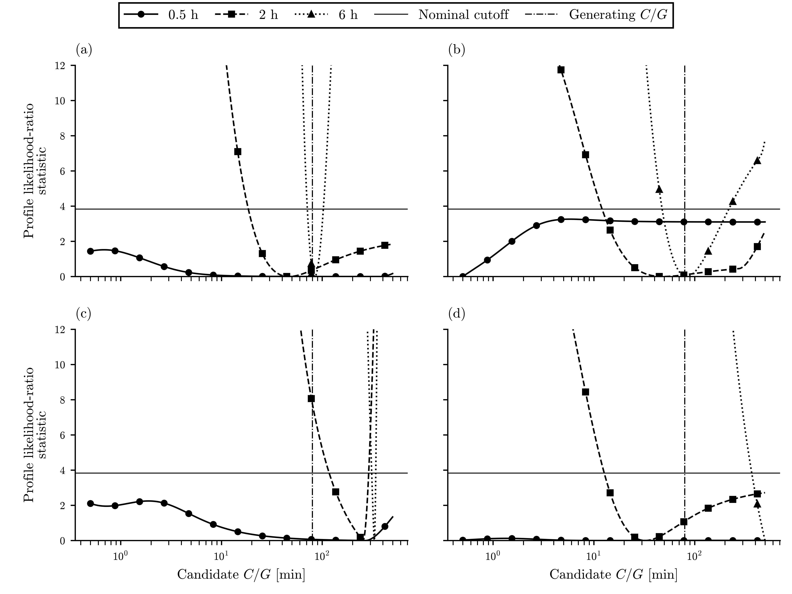
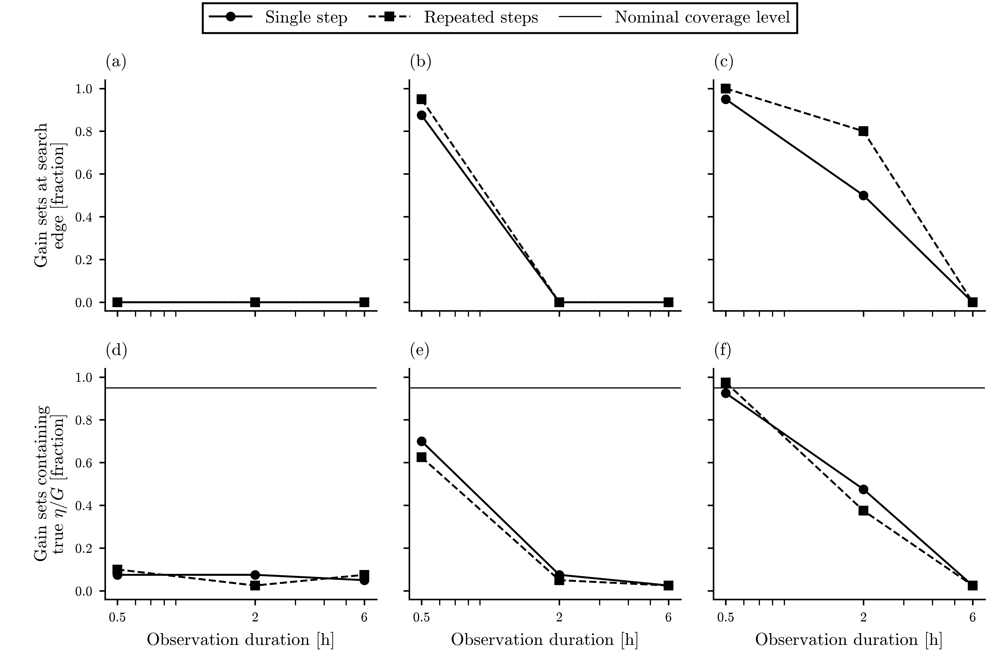

# Executed synthetic I1 design aid

Executed 72 scenario cells with 2880 synthetic fits. Estimation-only reporting is retained.

Source: [numeric result](synthetic_identifiability.json), [all-cell CSV](synthetic_identifiability.csv), [profile arrays](synthetic_identifiability_profiles.npz). This page is generated from those outputs.

## What the calculation supports

Power-only interventions identify C/G and eta/G under the single-node model. Jointly scaling C, G and eta leaves the trajectory invariant. The [derivation and registration](../identifiability_design.md) explain which independent heat-path input would fix the scale.

Longer records usually reduce open profiles in the matched scenarios. The isolated power block gives narrower gain sets than the repeated schedule in the matched cells where both sets close. This compares equal energy and duration under these assumed response/noise conditions; it does not remove the physical protocol's replication and counterbalancing requirement.

Ambient mismatch can produce narrow sets with poor coverage. Extra probe lag also biases the single-node interpretation. A small residual variance alone does not establish an adequate thermal structure. No physical detection limit, preferred enclosure or calibration-transfer performance follows from this study.

## Slow-response comparison

Generating heater time constant: 80 min. Every registered duration and schedule is shown for this slice; other time constants remain in the CSV. Open means a profile set reaches the registered search boundary. Coverage uses all draws, including open sets.

| Scenario | Duration [h] | Schedule | Gain coverage [%] | Gain open [%] | Time-constant open [%] |
| --- | ---: | --- | ---: | ---: | ---: |
| matched | 0.5 | single step | 97.5 | 95.0 | 90.0 |
| matched | 0.5 | repeated steps | 97.5 | 100.0 | 92.5 |
| matched | 2 | single step | 95.0 | 50.0 | 57.5 |
| matched | 2 | repeated steps | 97.5 | 80.0 | 62.5 |
| matched | 6 | single step | 87.5 | 0.0 | 0.0 |
| matched | 6 | repeated steps | 92.5 | 0.0 | 0.0 |
| noisy | 0.5 | single step | 92.5 | 97.5 | 95.0 |
| noisy | 0.5 | repeated steps | 92.5 | 97.5 | 97.5 |
| noisy | 2 | single step | 95.0 | 95.0 | 77.5 |
| noisy | 2 | repeated steps | 90.0 | 92.5 | 82.5 |
| noisy | 6 | single step | 90.0 | 0.0 | 17.5 |
| noisy | 6 | repeated steps | 97.5 | 30.0 | 35.0 |
| ambient mismatch | 0.5 | single step | 92.5 | 92.5 | 72.5 |
| ambient mismatch | 0.5 | repeated steps | 97.5 | 100.0 | 92.5 |
| ambient mismatch | 2 | single step | 47.5 | 32.5 | 27.5 |
| ambient mismatch | 2 | repeated steps | 37.5 | 72.5 | 40.0 |
| ambient mismatch | 6 | single step | 2.5 | 0.0 | 12.5 |
| ambient mismatch | 6 | repeated steps | 2.5 | 32.5 | 20.0 |
| probe lag | 0.5 | single step | 95.0 | 97.5 | 100.0 |
| probe lag | 0.5 | repeated steps | 95.0 | 100.0 | 100.0 |
| probe lag | 2 | single step | 100.0 | 7.5 | 100.0 |
| probe lag | 2 | repeated steps | 57.5 | 95.0 | 62.5 |
| probe lag | 6 | single step | 0.0 | 10.0 | 100.0 |
| probe lag | 6 | repeated steps | 0.0 | 0.0 | 100.0 |

## Profiles and schedule tradeoffs

[Vector profiles](../figures/synthetic_identifiability_profiles.svg). First registered draw, slow-response case and repeated steps throughout. The vertical line marks the generating heater constant. In the probe-lag case there is no true single-node time constant. All full-range profiles are retained; the figure clips high likelihood-ratio values for readability.

[Vector tradeoffs](../figures/synthetic_identifiability_tradeoffs.svg). The dotted coverage reference is nominal, not a measured performance target. Lines connect discrete scenarios and do not establish interpolation to an untested schedule.

The JSON duration_information entries give paired log width reduction relative to the shortest same-schedule record. paired_schedule_widths compares single versus repeated steps. Positive values mean narrower repeated-step sets. These are descriptive information proxies, not Bayesian information or entropy. Only pairs with both sets closed contribute; their counts are reported. Null means no eligible pair. They must be read alongside openness and coverage, rather than used to rank schedules alone.

## Numerical validation and resource use

The refinement doubled profile-grid resolution to 3201 points on the same draws. Time-constant coverage changed in 0 fits and gain coverage in 0 fits. Maximum relative estimate changes were 0.22% for time constant and 4.32% for gain. The discrete grid includes each generating time constant to avoid an off-grid truth; this favors recovery slightly compared with an unknown physical parameter. Grid agreement on coverage does not prove continuous optimization accuracy or calibrated uncertainty.

Discrete profile descent from the registered starts reached inferior minima in 7 first-draw cells. The largest excess likelihood-ratio statistic was 14.91. Published fits instead use the minimum across the entire registered grid. The per-cell multiple_starts records preserve these failures; each key and seed regenerates its input.

Exact response superposition, independent RK4, joint-scaling trajectories and interval energy checks passed. Maximum interval-energy residual: 3.55e-14 J. A direct GLS solve independently checked variable projection, and the AR(1) whitening norm matched the full covariance inverse.

| Computation | Elapsed [s] | Peak RSS [MiB] |
| --- | ---: | ---: |
| Registered matrix | 29.33 | 639.2 |
| Profile refinement | 38.69 | 850.1 |

Raw synthetic arrays: 4.17 MiB, retained outside git with per-file hashes. Both runs used one worker and one BLAS/OpenMP thread. Checkpoints contain the exact configuration, generator hash and completed cells.

## Interpretation limits and next input

Each cell has 40 Monte Carlo draws. The maximum binomial Monte Carlo standard error is 7.9 percentage points; the small batches describe failure regimes and do not precisely calibrate nominal coverage. Schedules and durations share random draws; cells are not independent physical replications. Known noise covariance is optimistic, quantization is omitted from the fit covariance, and the ambient excursion period scales with observation duration. Thus the mismatch duration comparison changes both exposure length and drift time scale. Constant calibration offset is profiled as a nuisance; time-varying calibration and power-meter errors need actual specifications.

The profile sets are asymptotic marginal likelihood-ratio sets over finite search domains. Disconnected components and open edges are retained. The CSV's finite-domain widths include truncation and must not be read as finite uncertainty bounds. For probe-lag rows, time-constant inclusion only asks whether the generating heater constant is inside the fitted set; it is not valid coverage of a nonexistent single-node truth.

The owner still supplies the [meeting and rig inputs](../../docs/COLOCATION_OWNER_SESSION.md#current-blocker). Actual response, ambient-channel quality, noise, calibrated power/coupling and airflow independence could change the schedule comparison. Physical M1/M2, I1, protocol freeze and held-out-design comparison remain pending.
