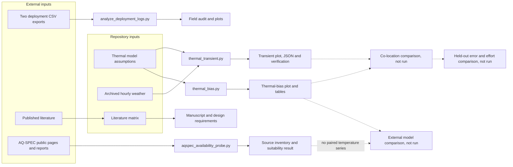

# Data and figure production

This document explains where the repository's reported data come from, how each
result figure is produced, and which parts can be reproduced from the clone
alone.



## Evidence classes

| Class | Meaning in this repository |
| --- | --- |
| Field-log analysis | Calculations made from device exports collected during bench and outdoor operation |
| Analytical simulation | Lumped steady-state and single-node transient heat-balance calculations, without a spatial mesh |
| Literature synthesis | Values extracted or summarized from cited publications |
| External-data probe | Retrieval and inspection of public sources; no measurements extracted |
| Planned analysis | CAD, FEA, calibration, or validation steps that do not yet produce results |

## Deployment-log plots

Generator: [`analysis/analyze_deployment_logs.py`](../analysis/analyze_deployment_logs.py)

Required external files:

- `data1.3_24 - Sheet1.csv` (Log A)
- `data2_5_29 - Sheet1.csv` (Log B)

The script requires an explicit data directory; it has no machine-specific
default. The path below is a placeholder for authorized external exports:

```bash
python analysis/analyze_deployment_logs.py \
  --data-dir /path/to/DataEnclosure \
  --out-dir analysis/output
```

The audit parses timestamps, treats `reset_reason == "BROWNOUT"` as a brownout
row, treats `last_post_ok == 1` as a successful post, replaces battery
temperature sentinels at or below −40, and flags `hum == 0` environmental rows.
An operational row requires `DEEPSLEEP_WAKE` and humidity above zero. The
provisional outdoor window for Log A is 2026-04-20 through 2026-05-11.

That window is retained for exploratory descriptive summaries, not used to
invent configured completeness. Since the 2026-09-05 accounting correction,
completeness is unavailable unless an intended start/end and cadence are
supplied. New output must be kept separate from historical published field
rates until their denominators are reconciled. See [RELIABILITY_METRICS.md](RELIABILITY_METRICS.md).

The command writes `analysis/output/results.md` plus four plots. Three are kept
in `analysis/figures/` under publication-oriented names:

| Committed output | Script output before copy/rename |
| --- | --- |
| `deployment_daily_brownout.png` | `fig1_daily_brownout_fraction.png` |
| `deployment_battv_outcome.png` | `fig3_battv_by_outcome.png` |
| `deployment_temp_window.png` | `fig4_temp_deployment_window.png` |

It also writes filtered CSV subsets beside the raw input under `derived/`.
Those subsets and the source exports are intentionally outside version control.
The script records input SHA-256 prefixes in its generated report so a run can
be tied to specific source files.

## Thermal-bias plot

Model: [`analysis/thermal_bias.py`](../analysis/thermal_bias.py). Drawing:
[`analysis/matlab/make_thermal_bias.m`](../analysis/matlab/make_thermal_bias.m).

```bash
python analysis/thermal_bias.py
matlab -batch "addpath('analysis/matlab'); render_figures"
```

The script solves a lumped steady-state energy balance for absorbed solar and
internal heat against convection and long-wave radiation. It converts predicted
sensor temperature rise into relative-humidity error at fixed water-vapor
partial pressure, and sweeps solar loading and wind speed. It writes the plotted
sweep to `analysis/figures/data/thermal_bias_sweep.csv` and the caption file
`analysis/figures/thermal_bias.caption.md`. The MATLAB script checks the sweep
against the committed day table, then writes `analysis/figures/thermal_bias.png`
(300 dpi) and its vector PDF. Each variant has its own column; blue solid and
orange dashed lines distinguish solar loading. RH differences are in percentage points.

The assumptions are encoded in the script and tabulated in
[`analysis/thermal_bias_results.md`](../analysis/thermal_bias_results.md). The
model is not fitted to the deployment logs. Its comparison with published
measurements is a literature bracket, not a validation using this enclosure.

## Transient prediction plot

The [corrected JSON](../analysis/output/thermal_transient_prediction.json) and
plot data come from [`analysis/thermal_transient.py`](../analysis/thermal_transient.py);
[`analysis/matlab/make_thermal_transient.m`](../analysis/matlab/make_thermal_transient.m)
draws the figure. Reproduce into fresh paths:

```bash
python -m analysis.thermal_transient --json /tmp/enclosure-transient.json --figure-data /tmp/enclosure-transient.csv
python -m analysis.verify_thermal_transient --out /tmp/enclosure-verification.json
```

Without `--figure-data`, the first command writes
`analysis/figures/data/thermal_transient_series.csv`, which the MATLAB script
reads. That file keeps every fifth 1-min step of the retained period. Hour
boundaries fall on kept rows, so the solar steps are exact. Caption numbers come
from the full 1-min arrays.

The [weather bytes](../analysis/input/openmeteo_brooklyn_20260901_20260914.json)
are unchanged. Their acquisition request, retrieval date and product/version
are unknown. The output records the hash, source definitions, time support and
integrated radiation energy. Instantaneous inputs are interpolated; solar means
are constant over their preceding hours. Figure timestamps are UTC and the
final partial day is excluded from mean daily peaks, while its intervals remain
in duration-weighted means.

The PNG and SVG separate solar and wind forcing into aligned panels above one
bias panel per variant. Markers identify the variant and do not subsample the
calculation. The primary plot uses an explicit clear-sky assumption with uniform input
sensitivity bands. The JSON also reports a nominal fully opaque sky scenario.
Total cloud cover is not silently substituted for opaque cover. These are
assumptions, not measured sky forcing or a calibrated prediction interval.
[Verification](../analysis/output/thermal_transient_verification.json) records
exact-RC error, energy preservation and timestep refinement for nominal and two
joint parameter corners under both sky assumptions. It does not check every
parameter combination or establish physical accuracy. [Review status](results.md#transient-result)
and [original artifacts](history/README.md) distinguish current and superseded outputs.

## External-data suitability probe

Generator: [`analysis/aqspec_availability_probe.py`](../analysis/aqspec_availability_probe.py)

```bash
python3 analysis/aqspec_availability_probe.py /absolute/external/aqspec-probe
```

The probe needs network access, `curl` and Poppler's `pdftotext`. It writes
downloads and extracted text to the external directory. The committed
[source inventory](../analysis/results/aqspec_source_inventory.json) and the
[suitability result](../analysis/aqspec_feasibility.md) are its only outputs in
git. No figure is produced: the probe found no paired sensor/reference
temperature series to plot.

## Literature records and report visuals

`literature/literature_matrix.csv`, the bibliography, the cross-source summary,
and `ProConsList/` form the source-traceability layer. Run:

```bash
python analysis/check_literature_coverage.py
```

The files under `deliverables/` and their rendered preview pages are document
layouts built from this material. They are not additional experimental results
and are excluded from the figure manifest.

## Reproduction boundary

The literature coverage check and both thermal models run from
repository-contained inputs. The AQ-SPEC probe re-downloads public sources, so
its result depends on what those sites serve at the time. Deployment plots
require the two external CSV exports. Accuracy, calibration, heat-soak, and
spatial FEA plots cannot be regenerated because their planned input data or
solver implementation do not yet exist.

[`figure-manifest.json`](figure-manifest.json) provides the same figure lineage
in a machine-readable form.

## Visual revision and retained material

Python computes every plotted value and MATLAB R2025b draws the figures. The
Python steps write the plotted series to `analysis/figures/data/` and the caption
files to `analysis/figures/<name>.caption.md`. The scripts in
[`analysis/matlab/`](../analysis/matlab/README.md) read those files and the
committed results, and write each figure as a 300-dpi PNG and a vector PDF at the
paths the documents link. One command draws all of them:

```bash
matlab -batch "addpath('analysis/matlab'); render_figures"
```

The canvas holds data, axes, tick and axis labels, panel letters with short
panel names, and direct series labels. Text is set with MATLAB's LaTeX
interpreter in Computer Modern. MATLAB's first default colour (blue) marks the
first series and its second (orange) the comparison, always with a second cue
(solid or dashed line, filled or hollow marker). The profile figure needs three
record lengths, so it adds the fourth default colour (purple) and a dotted line.
Reference lines are grey and dotted, labelled once. Titles, notes and results
stay in the caption files, with every number computed from the plotted values;
the documents under each image repeat them. No inputs, draws, exclusions,
summaries or uncertainty interpretation changed.

Five steady result tables are typeset with booktabs and siunitx.
[`make_rise_table.m`](../analysis/matlab/make_rise_table.m) and
[`make_result_tables.m`](../analysis/matlab/make_result_tables.m) read the
committed CSVs and write LaTeX fragments to `analysis/figures/tables/`. Each
fragment is compiled to a PDF and a 300-dpi PNG. The documents show the PNG and
keep the Markdown table under "Table as text", so the values stay searchable.

| Active visual or table | Treatment and reason |
| --- | --- |
| Steady thermal figure | MATLAB; one column per variant, temperature and RH rows with shared axes, solar loads labelled in panel (e); PNG, PDF and caption |
| Transient figure | MATLAB; forcing panels above one bias panel per variant on a shared UTC axis, median and band labelled once; PNG, PDF and caption |
| Synthetic I1 figures | MATLAB; record lengths and schedules labelled on the canvas, scenario and heater time constant in panel names; PNG, PDF and caption |
| README prediction table and steady result tables | Typeset from the committed CSVs; Markdown kept under "Table as text" |
| Model equations | GitHub math in the model, design, protocol and Study A documents |
| Deployment figures and historical metrics | Original images/values retained because source exports are unavailable |
| Overview diagram and roadmap dependency graph | Retained: conceptual dependencies, with no numerical axes to redesign |
| Frozen manuscript, deliverables and archived evidence | Retained unchanged to preserve historical release and evidence provenance |

Use temporary result paths in the commands above to preserve the committed
numerical records and their original software hashes. The figure manifest lists
the figure-only outputs and their result sources. The source-file hash in a
historical result identifies that result's generator version, not the latest
plotting-only revision.

## Synthetic I1 design aid

[Registration and derivation](../analysis/identifiability_design.md) specify the
assumed domains and structural ambiguity before results. Reproduce the full
synthetic matrix, its grid-resolution check and generated report/figures with:

```bash
export OPENBLAS_NUM_THREADS=1 OMP_NUM_THREADS=1 VECLIB_MAXIMUM_THREADS=1
python -m analysis.synthetic_identifiability --out /tmp/enclosure-design --raw /tmp/enclosure-design/raw
python -m analysis.verify_synthetic_identifiability /tmp/enclosure-design/identifiability_checkpoint.json --out /tmp/enclosure-design/refinement.json
python -m analysis.render_identifiability --checkpoint /tmp/enclosure-design/identifiability_checkpoint.json --refinement /tmp/enclosure-design/refinement.json
```

Use an empty output directory for a new run. A stopped matrix resumes with the
same first command plus `--resume`; the configuration and generator hashes must
match. The checkpoint is written after every cell. Source hashes identify the
executed versions, and cell keys plus seed sequences regenerate individual
examples. The raw NPZ arrays remain outside git, with hashes in the compact
[result](../analysis/output/synthetic_identifiability.json). No external dataset
or field measurement enters this calculation.

To redraw without repeating computation:

```bash
python -m analysis.render_identifiability
matlab -batch "addpath('analysis/matlab'); render_figures"
```

The [registered 60 s cadence amendment](../analysis/input/identifiability_design_60s.json)
reruns the same matrix with `--config`. Its outputs carry the `_60s` suffix
(`analysis/output/synthetic_identifiability_60s.json`, `.csv`, `_profiles.npz`,
`_report.md` and the two `analysis/figures/synthetic_identifiability_60s_*`
figures); the registered 15 s files are untouched:

```bash
python -m analysis.synthetic_identifiability --config analysis/input/identifiability_design_60s.json --out /tmp/enclosure-design-60s --raw /tmp/enclosure-design-60s/raw
python -m analysis.verify_synthetic_identifiability /tmp/enclosure-design-60s/identifiability_checkpoint.json --out /tmp/enclosure-design-60s/refinement.json
python -m analysis.render_identifiability --checkpoint /tmp/enclosure-design-60s/identifiability_checkpoint.json --refinement /tmp/enclosure-design-60s/refinement.json --output analysis/output/synthetic_identifiability_60s.json
python -m analysis.render_identifiability --output analysis/output/synthetic_identifiability_60s.json
matlab -batch "addpath('analysis/matlab'); render_figures"
```

The renderer names plot data, captions and the report from the output stem and
reads the configuration recorded in the result, so the fourth command rewrites
the amended run's plot data alone. `render_figures` draws both runs; the 60 s
figures come from the same MATLAB scripts with the `_60s` stem and
configuration. An amended result also carries a `cadence_comparison` block
with every cell beside its registered counterpart.

The renderer reads the result and compressed profile arrays. It writes the
plotted profiles to `analysis/figures/data/<stem>_profiles.csv`,
the caption files and a Markdown report that repeats the captions. The MATLAB
scripts draw the PNG and PDF figures; the tradeoff figure reads the all-cell CSV directly. The all-cell CSV is generated on export;
missing finite log widths are empty cells. Runtime and peak memory are machine
observations, so regenerated resource fields and byte hashes may differ across
environments. Scientific comparisons should use numeric arrays and tolerances.
