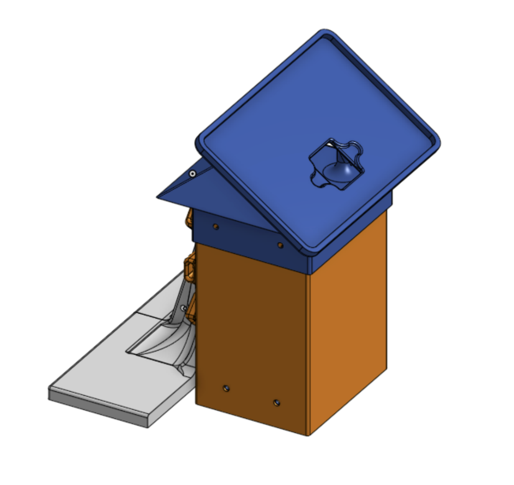
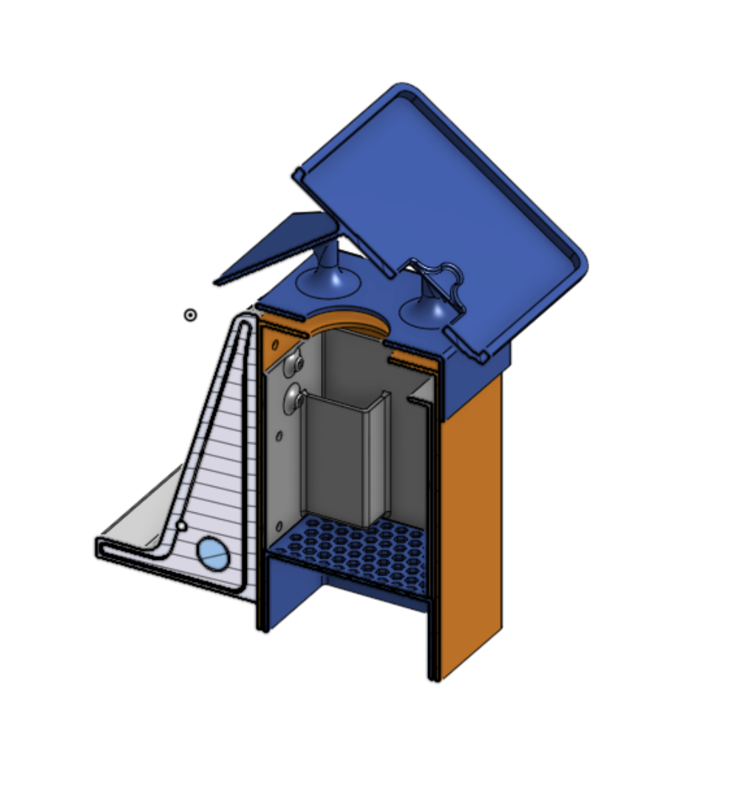
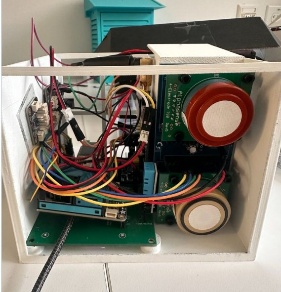

# Enclosure hardware record

Four printed housing revisions addressed sensor airflow, rain protection,
mounting, cable routing and service access. The work included enclosure CAD,
fabrication, sensor and power integration, and electrical debugging.

*Printed enclosure prototype installed on a railing.*

*Assembly CAD for the fourth physical-design revision.*

*Sectioned view of the component layout.*

*Early housing and wiring during integration.*

These are the existing build photographs and CAD renders from the owner's
[portfolio case study](https://www.mergenulziibayar.com/projects/sensor-enclosure-bias-prediction).
[Sources and hashes](sources.json) identify the imported bytes. Physical-design
revision names are historical; they are separate from the V0/V0P/V1 thermal-model
variants. The photographs document construction and installation. Thermal accuracy
and design transfer remain the questions in the [research roadmap](../../ROADMAP.md).
