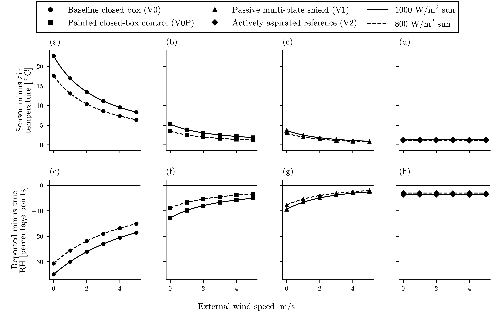
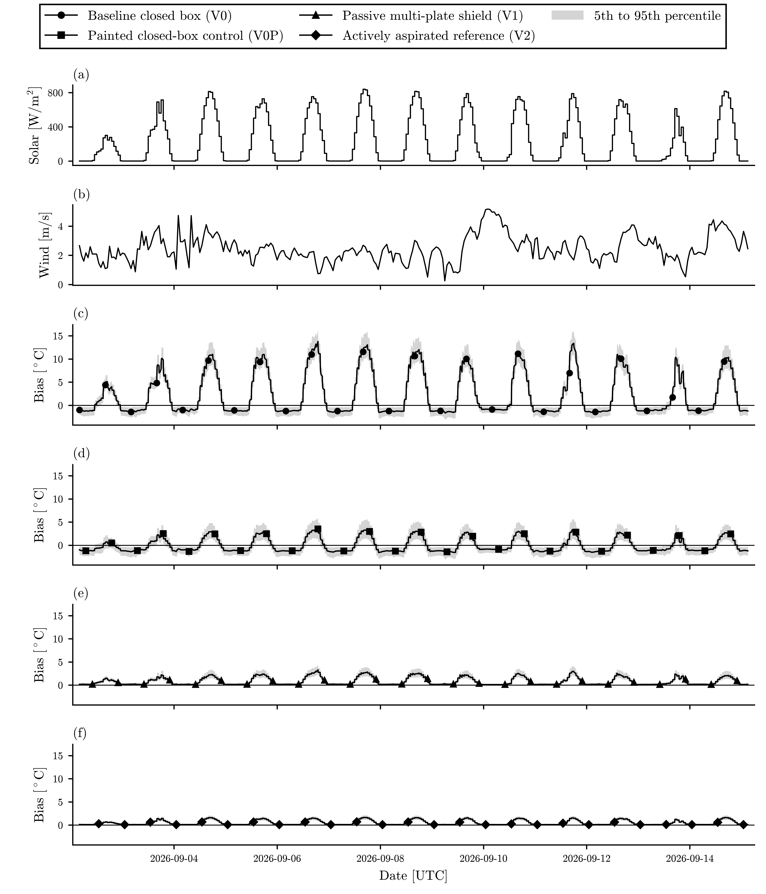

# Results

This page collects the current outputs. It separates deployment-log observations
from analytical predictions because they have different evidence sources and
validation requirements.

## Deployment-log reliability

The first audit uses two CSV exports stored outside this repository. The outdoor
window is inferred from the internal temperature and humidity signature and
still needs confirmation against the deployment record.

For the provisional 22-day outdoor window in Log A, the manuscript reports:

| Historical metric | Reported value | Unit |
| --- | ---: | --- |
| Upload success | 95.7 | % of received records |
| Data completeness | 91.4 | % under former estimator |
| Brownout resets | 0 | count |

Source: [retained manuscript](../paper/manuscript_v1.md); accounting qualification below.

These values describe delivery and continuity, not measurement accuracy. A
reference co-location dataset is still required for accuracy and calibration
claims.

**Accounting correction, 2026-09-05:** the numbers above are historical,
reported-but-unverified outputs retained for traceability. The former estimator
counted rows over an observed span and unconfirmed six-minute cadence; duplicate
rows and missing edge intervals could inflate completeness. The revised code
requires an explicit intended schedule and counts unique occupied slots. No
revised field percentage has been computed without the private exports and
confirmed provenance. Upload success is a fraction of received records, not
end-to-end delivery probability or wall-clock uptime. See
[metric definitions](RELIABILITY_METRICS.md) and the
[prepared provenance request](DEPLOYMENT_PROVENANCE_REQUEST.md).

These original plots are retained at full reading width. Source exports are
unavailable, so this visual revision does not regenerate them. Straight lines
across missing timestamps in the temperature plot do not establish observations
or continuous operation during those gaps.

The full audit script defines brownout rows, successful posts, missing-value
sentinels, environmental QC flags, and the operational-row filter. Raw CSVs are
not included, so another user cannot independently regenerate these field plots
without obtaining the source exports.

## Thermal-bias model

The [committed day table](../analysis/output/thermal_bias_table.csv) contains
nominal point estimates for the dark box, painted control and shield variants.
The [model interpretation](../analysis/thermal_bias_results.md) records their
assumptions and the combined sensitivity settings that reverse the shield's
nominal advantage over the painted box. Geometry, heat coupling and airflow
differ across those systems, so this comparison establishes no design preference.

Simulation: nominal steady-state bias from the lumped heat-balance model, without propagated input uncertainty. Air 30 °C, true RH 50 %, clear sky 20 K below air. Panels (a) to (d) show sensor minus air temperature and panels (e) to (h) reported minus true relative humidity in percentage points, against external wind speed from 0 to 5 m/s, for the baseline closed box (V0, circles; (a) and (e)), painted closed-box control (V0P, squares; (b) and (f)), passive multi-plate shield (V1, triangles; (c) and (g)), and actively aspirated reference (V2, diamonds; (d) and (h)). Solid lines are 1000 W/m² of sun and dashed lines 800 W/m². Panels in a row share axes. The thin line marks zero: above it the sensor reads warm, below it the sensor reads dry. Across both solar loads the baseline box reads 6 to 23 °C warm and 15 to 35 points dry; the other three read 0.7 to 5.3 °C warm and 2 to 13 points dry. Values at five wind speeds: `analysis/output/thermal_bias_table.csv`. Model and inputs: `analysis/thermal_bias.py`.

[Caption](../analysis/figures/thermal_bias.caption.md) ·
[Vector figure](../analysis/figures/thermal_bias.svg).

The figure shows nominal values. The [uncertainty module](../analysis/uncertainty.py)
is connected to the day and night tables by
[`analysis/steady_uncertainty.py`](../analysis/steady_uncertainty.py), which
propagates the input ranges the repository already declares (the transient
priors recorded in the [prediction JSON](../analysis/output/thermal_transient_prediction.json)
and their rows in the [parameter register](PARAMETER_REGISTER.csv)) linearly
through the steady solver at every committed operating point. Each range is
rectangular, u = (high - low)/sqrt(12). Areas, the fan coefficient, the
pre-heat half-life and the operating point (air, RH, wind, solar load and the
20 K sky depression) are held fixed because no range is documented for them.
The k = 2 intervals below carry no coverage probability. Nominal values are
unchanged.

| Wind [m/s] | Baseline closed box (V0) [°C] | Painted closed-box control (V0P) [°C] | Passive multi-plate shield (V1) [°C] | Actively aspirated reference (V2) [°C] | V0P minus V1 [°C] |
| ---: | ---: | ---: | ---: | ---: | ---: |
| 0.0 | 22.66 (18.01 to 27.32) | 5.30 (1.01 to 9.58) | 3.69 (1.97 to 5.41) | 1.35 (0.70 to 1.99) | 1.61 (-2.09 to 5.31) |
| 0.5 | 19.42 (15.57 to 23.26) | 4.48 (0.86 to 8.10) | 3.00 (1.60 to 4.40) | 1.35 (0.70 to 1.99) | 1.48 (-1.66 to 4.62) |
| 1.0 | 16.95 (13.58 to 20.33) | 3.88 (0.74 to 7.02) | 2.50 (1.32 to 3.68) | 1.35 (0.70 to 1.99) | 1.38 (-1.35 to 4.11) |
| 2.0 | 13.49 (10.66 to 16.33) | 3.06 (0.57 to 5.55) | 1.82 (0.93 to 2.71) | 1.35 (0.70 to 1.99) | 1.24 (-0.91 to 3.39) |
| 5.0 | 8.32 (6.29 to 10.36) | 1.87 (0.33 to 3.41) | 0.91 (0.40 to 1.42) | 1.35 (0.70 to 1.99) | 0.96 (-0.36 to 2.28) |

Nominal sensor minus air temperature with its k = 2 interval at 1000 W/m² of
sun and 30 °C air. Source: [intervals CSV](../analysis/output/thermal_bias_uncertainty.csv)
for every day and night point and
[budget JSON](../analysis/output/thermal_bias_uncertainty.json) for the
per-input variance terms and the paired contrast at each day point.

At 1000 W/m² and 0.5 m/s the V0P and V1 intervals overlap, and the paired
V0P minus V1 contrast, with the shared inputs cancelling, has u_c 1.57 °C
against a nominal 1.48 °C, so its k = 2 interval includes zero. The same holds
at every day point. The contrast budget is dominated by the light-finish
absorptance (P-ALPHA-SH) and the box sky-view fraction (P-FSKY-V0), neither
measured for this hardware. The nominal shield advantage therefore sits inside
model-input uncertainty, and the I5 contrast (V0P against V1) cannot be
pre-registered as a model-discriminating test. This agrees with the
[2026-09-24 withdrawals](SPRINT_PROGRESS.md), which removed the earlier
uncertainty and day/night discriminator claims. At night (0 W/m², calm) the
closed box's interval, -6.51 to -1.54 °C, stays below zero and the shield's,
-0.59 to 0.57 °C, straddles it, with the sky depression held at 20 K. Three
ranges (shield solar factor, convection boost and plate pre-heat) are one-sided
from the nominal; the linear terms do not carry that direction or the solver's
nonlinearity, and the [matched-control screen](../analysis/thermal_bias_results.md)
already shows the far-end combination reversing the sign. A measured range for
absorptance or sky view narrow enough to separate the two intervals, or a
measured contrast outside them, would change this reading. These are
analytical outputs; no physical thermal comparison or FEA validation is
supplied by this figure.

## Transient result

[PR #56](https://github.com/500ft/sensor-enclosure-thermal-design/pull/56)
merged the corrected sensitivity calculation and [executed numerical
verification](../analysis/output/thermal_transient_verification.json).
The [prediction JSON](../analysis/output/thermal_transient_prediction.json) is
the source for the current scenario summaries, parameter draws, paired signed
contrast, finite heat secant and weather provenance. The owner approved the merge on 2026-10-06
after an agent inspection of the corrected integration loop. The prediction
JSON's `status` field was written before that approval and still says HOLD; it
changes at the next regeneration. [Original artifacts](history/README.md) remain available.

Simulation: clear-sky scenario driven by archived hourly Open-Meteo weather from 2026-09-02 04:00 to 2026-09-15 03:00 UTC; the first 24 h are spin-up and are not shown. Panel (a) is the hourly mean solar irradiance, held over each preceding hour; daily peaks range from 300 to 839 W/m². Panel (b) is the wind speed at 10 m, between 0.25 and 5.2 m/s. Panels (c) to (f) share axes and show sensor minus air temperature for the baseline closed box (V0, circles; (c)), painted closed-box control (V0P, squares; (d)), passive multi-plate shield (V1, triangles; (e)), and actively aspirated reference (V2, diamonds; (f)). Each line is the median of 400 input draws and the grey band spans their 5th to 95th percentiles; the bands show sensitivity to assumed input ranges, not measured uncertainty. Above the thin zero line the sensor reads warm. The baseline box's median bias peaks at 5 to 14 °C each day; the other three stay below 4 °C. The final day is incomplete. Summaries: `analysis/output/thermal_transient_prediction.json`. Weather: `analysis/input/openmeteo_brooklyn_20260901_20260914.json`. Model: `analysis/thermal_transient.py`.

Each variant keeps the marker it has in the steady figure above.
[Caption](../analysis/figures/thermal_transient_prediction.caption.md) ·
[Vector figure](../analysis/figures/thermal_transient_prediction.svg).

| Review item | Implemented correction and evidence |
| --- | --- |
| Initial state and integration | Save the initial state at its timestamp; integrate actual intervals with midpoint instantaneous forcing and a local exponential tangent step. Exact-RC, irregular-step, zero-loss and nonlinear-refinement checks exercise the actual solver. |
| Forcing time | Hold each preceding-hour solar mean over its source interval, retaining every hourly boundary. Check timestamps and units. Exclude the unsupported first solar hour; stop at the final timestamp. Use duration-weighted means and complete-day peaks; report partial-day support and absolute UTC labels. |
| Provenance and sky model | Keep raw weather bytes/hash. Request, retrieval date and product/version remain explicitly unknown. Replace the hybrid with the sourced Clark-Allen clear-sky equation and Walton opaque-cloud correction. Because the file supplies total cloud rather than opaque cloud, report explicit clear and fully opaque scenarios, not inferred sky measurements or guaranteed bounds. |
| Interpretation | Uniform assumed-input quantiles remain sensitivity ranges. A shared-draw V1-minus-V0P signed-bias contrast is reported directly; marginal overlap supplies no paired inference. The I1 calculation is a finite secant per effective coupled heat, with its steady sky assumption stated. It does not identify supply-to-sensor heat coupling. |
| Decisions and registration | Record owner-authorized geometry/calibration-transfer direction while retaining estimation-only first-stage reporting, I1 first and PI/physical gates. The model, processing, coefficients and weather procedure must be frozen before later outcomes. |
| Integration and review | Current main is incorporated. Only transient outputs were regenerated after the corrections and numerical checks; raw weather and steady tables remain unchanged. Merged on owner approval; unresolved acquisition evidence remains explicit. |

The [Open-Meteo definitions](https://open-meteo.com/en/docs/historical-weather-api)
identify the solar interval convention and total cloud variable. The
[EnergyPlus equation and opaque-cover definition](https://energyplus.readthedocs.io/en/stable/auxiliary-programs/auxiliary-programs.html#field-horizontal-infrared-radiation-intensity)
support the implemented sky scenarios. Neither source recovers this file's lost
acquisition details. Hourly grid forcing cannot establish minute-scale exposure
at the rig. Assumed input ranges and sky scenarios do not yield calibrated
prediction intervals or a measured design ranking.

The thermal-step check supports the single-node reasoning: the steady step
identifies effective heat divided by conductance; the time constant identifies
capacity divided by conductance. Electrical power requires an identified heat
path. The correction does not establish multi-node or cross-geometry
identifiability. See the [I1 protocol](COLOCATION_PROTOCOL.md#i1-procedure-the-first-experiment)
and [current blocker](COLOCATION_OWNER_SESSION.md#current-blocker).

### RH interpretation

At fixed vapor partial pressure, `RH_sensor = RH_air * e_sat(T_air) /
e_sat(T_sensor)`. The [executed sensitivity calculation](../analysis/output/thermal_transient_verification.json)
records the temperature and humidity assumptions and the resulting percentage-point
errors. Moisture exchange or condensation would change this derivation. An
empirical PM correction trained on internal RH cannot automatically substitute
ambient RH without revalidation. No universal PM benefit or binding application
tolerance follows from this thermal calculation.

## Synthetic protocol-identifiability result

The [executed design aid](../analysis/output/synthetic_identifiability_report.md)
compares power schedules and observation durations under declared correlated
noise, calibration offset, quantization, ambient mismatch and probe lag.
It estimates capacity/conductance and coupling/conductance after proving why
power alone cannot separate the original physical parameters. Longer records
can reduce open profiles while model error defeats interval coverage. These
source-box ratios do not establish the geometry, material and heat-path relation
needed for a withheld enclosure; measuring that relation belongs in the total
effort comparison.

[Numeric results and all per-draw profile sets](../analysis/output/synthetic_identifiability.json),
[summary CSV](../analysis/output/synthetic_identifiability.csv) and
[registration/derivation](../analysis/identifiability_design.md) retain assumptions,
search boundaries and the Monte Carlo interpretation. The result includes
independent numerical checks and profile-grid refinement. This completes an
owner-authorized synthetic design study; physical M1/M2 and real I1 remain pending.

## Reading the evidence

| Output | Evidence type | Current limitation |
| --- | --- | --- |
| Deployment metrics and plots | Analysis of external field logs | Raw exports and confirmed deployment history are unavailable in the repository |
| Thermal-bias sweep | First-order analytical simulation | Nominal point estimates with linearly propagated declared-range intervals; not yet compared with external or co-location measurements |
| Transient prediction | Single-node transient simulation on archived hourly weather | Clear-sky and opaque-sky assumptions with assumed-input sensitivity bands; acquisition metadata unknown; no measured or held-out comparison |
| [External-data suitability](../analysis/aqspec_feasibility.md) | Access probe of AQ-SPEC public sources | Reports only; no paired sensor/reference temperature series or reuse terms obtained |
| Literature brackets | Published measurements summarized from cited sources | Not measurements of this enclosure |
| [Retained CAD](../cad/enclosure/v0/README.md) | Geometric acceptance evidence | Does not establish the current rig or thermal performance; unused FEA stub removed |

See [`data-and-figures.md`](data-and-figures.md) for the complete production path
and [`figure-manifest.json`](figure-manifest.json) for the machine-readable map.
